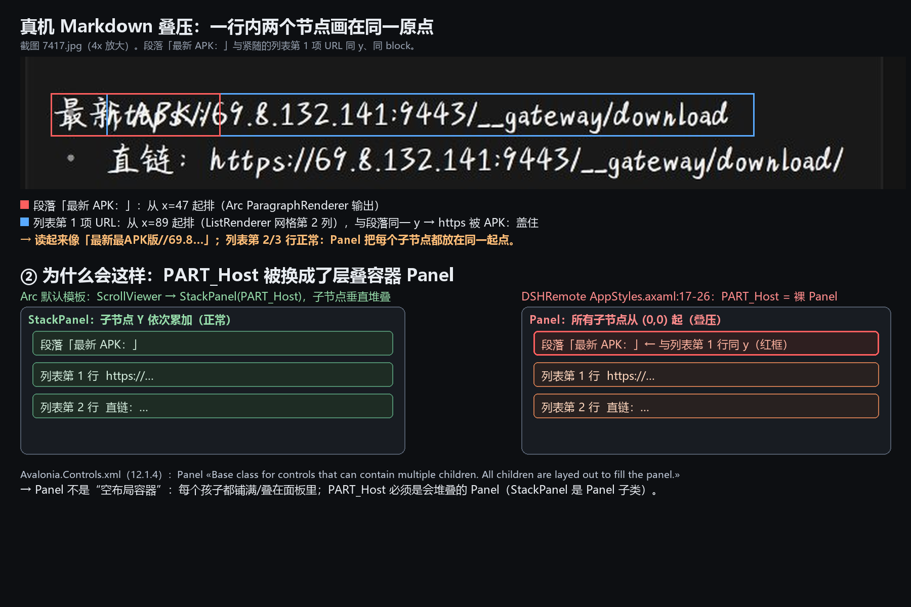

# 26 · 真机 Markdown「文字重叠」根因分析：是 Arc 组件库的设计问题吗？

> 日期：2026-11-10
> 对象：`DSHRemote`（Avalonia 12.1.4 / Android，通过 ProjectReference 使用本仓库的 Arc 源码）与 `Arc.Avalonia`
> 截图：真机 `PLQ110`（Android 16 / API 36，系统主题字体为手写体）
> 证据：`.recon/overlap/`（工作区临时）与 [`docs/images/markdown-overlap-*`](images/markdown-overlap-rootcause.png)
> 子报告：`docs/analysis/markdown-overlap/` 下 [arc-render.md](analysis/markdown-overlap/arc-render.md)、[dsh-remote-integration.md](analysis/markdown-overlap/dsh-remote-integration.md)、[avalonia-text-runtime.md](analysis/markdown-overlap/avalonia-text-runtime.md)

---

## 0. 结论（先给答案）

**本次截图中的「文字重叠」不是 Arc 组件库的渲染/布局缺陷。**
根因在 DSHRemote 的宿主层：它替换了 `ArcMarkdownView` 的控制模板，把 `PART_Host` 从 Arc 官方模板里的 `StackPanel` 换成了裸 `Panel`。Avalonia 的 `Panel` 是层叠容器（所有子控件被安排到同一矩形），而 **Arc 的文档视图依赖宿主做垂直堆叠**——于是同一个 `ArcMarkdownView` 里的多个 Markdown 顶层块（例如「段落 + 紧跟的列表」「表格 + 代码块」）全部画在同一个原点，形成「一行内两段文字水平叠压」。

但**这不等于 Arc 没有责任**。Arc 在这件事上暴露了三个真实的设计问题，它们让宿主踩坑几乎成为必然：

| # | Arc 侧问题 | 性质 | 与本次重叠的关系 |
|---|---|---|---|
| 1 | `PART_Host` 的「必须堆叠」契约隐式：只声明 `[TemplatePart(..., typeof(Panel))]`，无文档、无测试、无运行时校验 | 库级契约缺陷（中高） | **放大器**：宿主重模板时最自然的选择 `Panel` 恰好是错的 |
| 2 | 没有官方「无滚动 / 嵌入文档流」模式，宿主嵌入外层滚动列表只能重模板 | API 缺口（中） | **前置条件**：DSHRemote 正是为去掉内层 `ScrollViewer` 才重写了模板 |
| 3 | 行内链接用 `InlineUIContainer(HyperlinkButton)`（`NoWrap`、`Padding=2`、`MinHeight=24`） | 真实渲染缺陷（中） | 与本次叠压**无关**；它是「链接截断 / 基线不齐」的真正来源 |

另外两条常被一起提到的指控不成立：

- **「Markdown 行高塌陷」**：Markdown 渲染出的 `TextBlock` 不套 `arc-*` 类、也不设 `LineHeight`（`ArcMarkdownDefaults.cs:64-74`），行高完全来自字体度量，不存在「被绝对行高夹扁」的问题。旧版本里真正抬高行盒的是上面的行内链接控件，不是 LineHeight。
- **「模拟器正常、真机异常」**：模拟器镜像缺少 CJK 字体（中文是豆腐块，见 `docs/25-mobile-usage-guidance.zh.md:145-156`），且现有模拟器/桌面证据截图里没有出现过「段落紧跟列表」这种多节点组合。`Panel` 布局是纯托管、与平台无关，**同一条消息在桌面和模拟器上会同样叠压**。真机的手写主题字体只改变字宽、换行点和观感，不制造同 y 叠压。

**当前状态**：分析期间观察到 DSHRemote `app/src` 已于 13:59:10 把 `PART_Host` 改成了 `<StackPanel Spacing="0"/>`（与本文结论一致）；但它的两份影子副本 `_dev/validate`、`_dev/backup-app-src` 仍是旧的 `Panel` 版本，编译校验路径需要注意同步。用户手机上若仍安装旧 APK，会继续看到叠压。

---

## 1. 现场还原：叠的是哪两段文字

### 1.1 原始 Markdown

截图内容是 DSHRemote 会话里一条真实 assistant 消息，原文留档在 `DSHRemote/_dev/final-msg.md`：

```markdown
 7: 修复：
 8: - 重新 **clean 构建** v1.2.5，程序集存储恢复完整；
 9: - `scripts/build-release-apk.ps1` 现在每次发布前强制删除 …
...
47: **最新 APK**：
48: - <https://69.8.132.141:9443/__gateway/download>
49: - 直链：<https://69.8.132.141:9443/__gateway/download/dshremote-1.2.5-18-arm64-release.apk>
50: - 1.2.5 (18)，34.12 MB，sha256 `4f3f6ad7…`
```

注意两处**「段落 + 紧跟列表、中间没有空行」**的组合：`:7-8` 与 `:47-48`。

### 1.2 截图与原文逐行对位



（图上半：`7417.jpg` 4x 放大；红框=段落「最新 APK：」，蓝框=列表第 1 项 URL，两者同一 y。图下半：`StackPanel` 与 `Panel` 的宿主行为对比。）

| 截图现象 | 对应原文 | 说明 |
|---|---|---|
| `7417.jpg`：一行读成「最新最APK版//69.8.132.141:9443/__gateway/download」 | `:47` 段落 **最新 APK：** 与 `:48` 列表项 URL 同 y 叠压 | 粗体 `APK` 盖住 URL 的 `https`，全角 `：` 盖住 `s:`，于是只剩 `//69.8…` 可读 → 看起来像「链接被截断」 |
| 同图下方「• 直链：https://…」干净换行 | `:49` 列表第 2 项 | 同一个 `ListBlock` 内正常排布，说明列表自身没坏 |
| `7416.jpg`：「修复」与「重新 clean 构建…」叠在一起（「修」的字缝里能看到列表圆点） | `:7` 段落「修复：」与 `:8` 列表项同 y | **同一模式的第二次复现**（见 [第二处证据](images/markdown-overlap-second-site.png)） |
| 「文字重叠 / 基线不齐」的整体观感 | — | 叠压 + 段落用 Medium 粗体 + 真机手写体 CJK/Latin 墨迹比例不一致，三者叠加的视觉效果 |

> 附注：截图里 URL、sha256 等行后面的**灰色底纹是 `SelectableTextBlock` 的文字选择高亮**（`EnableTextSelection=true`，用户长按/拖选过），不是渲染错误，与分析无关。

### 1.3 像素级测量（排除「同一 TextBlock 内 run 推进错误」）

对 `7417.jpg` 做行/列墨迹分析：

- 段落文字从 **x≈47** 起排（`最` 47-71、`新` 75-99，`APK：` 103-170）；
- 列表内容列从 **x≈89** 起排（第 2 行「直链」实测 89 起，列表圆点在 x≈58）；
- 两段文字处于**同一个 y 带**（≈927-955），且**各自从自己的起点开始**；列表第 2/3 行（y≈964、1002）完全正常。

这排除了「一个 `TextBlock` 内两段 run 的 advance 算错」：两段内容分属两个独立控件（`ParagraphRenderer` 返回 `TextBlock`、`ListRenderer` 返回 `Grid`），却共享同一原点——这正是「两个控件被 arrange 到同一矩形」的特征。

---

## 2. 因果链（5 步，全部有代码证据）

1. **DSHRemote 覆盖了 `ArcMarkdownView` 的控制模板。**
   `DSHRemote/app/src/DshRemote.App/Theme/AppStyles.axaml:17-26` 重写了 `ControlTheme`，模板体是：
   ```xml
   <Panel x:Name="PART_Host" Background="{TemplateBinding Background}" />
   ```
   注释表明动机只是想「去掉内层 `ScrollViewer`，让外层滚动」。**改动把纵向堆叠语义一起删掉了却没有意识到。**

2. **Arc 官方模板依赖宿主堆叠。**
   本仓库默认模板是 `ScrollViewer → StackPanel(PART_Host)`（[ArcMarkdownView.axaml:22](../src/Components/Arc.Avalonia.Markdown/Themes/ArcMarkdownView.axaml)）。渲染入口只做 `_host.Children.Add(control)`，从不写 `Canvas.Top`/`Margin.Top` 之类的坐标（[ArcMarkdownView.cs:490-531](../src/Components/Arc.Avalonia.Markdown/Controls/ArcMarkdownView.cs)），所以**宿主是什么布局容器，直接决定块的垂直位置**。

3. **Avalonia 的 `Panel` 是层叠容器，不是「空布局」。**
   `Panel` 在 Avalonia 12.1.4 中没有覆写测量/排列，继承 `Layoutable` 的默认实现：每个子控件都用同一 `availableSize` 测量、返回**最大值**；排列时 `new Rect(finalSize)` 对每个子控件 `Arrange` 一次——**所有孩子共享同一矩形、同一原点**。包内 XML 文档原文：
   > *"Base class for controls that can contain multiple children. … All children are layed out to fill the panel."*
   对照 `StackPanel`：测量方向累加、排列按前一个孩子的尺寸递增 Y。
   （本仓库/DSHRemote 里 `Panel` 被当作叠层容器使用的现成例子：DSHRemote `ChatView.axaml:24-36` 用 `Panel` 把占位文字压在图片上。）
   本机 Headless 实验复核（`docs/analysis/markdown-overlap/avalonia-text-runtime.md` §1.2，Avalonia 12.1.5；`Panel.cs`/`Layoutable.cs` 在 12.1.4 与 12.1.5 逐行一致）：两个 `TextBlock` 放进裸 `Panel` 时两者 `Bounds` 都是 `(0,0,420×160)`、`DesiredSize` 只取最大值 `102×22`；放进 `StackPanel` 则是 `(0,0,420×22)` 与 `(0,22,420×22)`。

4. **DSHRemote 的「按空行拆块」workaround 只保证多数 group 只有一个节点。**
   `MarkdownBodyView` 用空行切分 Markdown，再给每个 group 一个 `ArcMarkdownView`（[MarkdownBodyView.cs:110-125](D:/Code/VibeCoding/DSHRemote/app/src/DshRemote.App/Controls/MarkdownBodyView.cs)）。但「段落 + 紧跟列表」之间**没有空行**，会留在同一个 group → 同一 `ArcMarkdownView` → `Panel` 里 2 个子控件 → 叠压。
   这也解释了历史结论「表格行压住代码块」：表格 `Grid` 与代码块 `Border` 在同一 group 里被同一 `Panel` 叠放。

5. **`ClipToBounds` 把「叠压」升级成「截断」观感。**
   `MarkdownBodyView` 自身与每个 `ArcMarkdownView` 都设了 `ClipToBounds=true`（`MarkdownBodyView.cs:43,52,136`）。被盖住的 URL 前缀、越界字形都会被硬裁，于是「链接截断」的错觉成立——数据其实没丢（列表第 2 项里 URL 是完整的）。

**为什么只有个别行炸、且只叠一行？** 段落控件高 1 行、列表从自己 y=0 开始；`Panel` 把两个控件都放在同一个矩形里，所以段落的第 1 行与列表第 1 行完全重合；列表第 2/3 行在列表内部按正常行高排布，因此不受影响。`Panel` 上报高度取最大子控件高度（列表更高），下方内容不被裁掉，与截图完全一致。

---

## 3. 为什么会被误判成 Arc 的问题

1. **代码注释先入为主。** `MarkdownBodyView.cs:13-16` 写着「Arc 的 Markdown 面在 Android 上会丢块高度、表格行盖住代码块」，`README.md:250/295/302/321` 也把「叠层」归因给 Arc 的文档级测量。这些注释是模板覆盖之后写的，归因错了；真正的「多层 text layout 叠在一个 block 里」正是他们自己的 `Panel`。
2. **真机字体放大了观感。** `ArcFontBody = FontFamily.Default`（`ArcPalette.cs:255-256`），DSHRemote 全程不配置字体；真机系统主题把手写体设为默认字体（连 App 壳层都是手写体）。手写体 CJK 墨迹偏小、Latin 偏大，混排看起来「字挤在一起」，容易让人以为 Arc 的行高/基线算法有问题。但它是**观感放大器**，不是同 y 叠压的原因。
3. **「模拟器正常」是无效对照。** 模拟器镜像缺 CJK 字体，中文渲染成豆腐块；现存模拟器/桌面证据截图（`task22-a-markdown-emulator.png`、`emulator-m6-arc-markdown.png`、`emulator-m6-arc-long-markdown.png` 等）都没有覆盖「段落紧跟列表」这种多节点 group，所以「看起来正常」只说明没测到。
4. **Arc 确实有真实缺陷。** 行内链接的 `HyperlinkButton` 方案、Android/模拟器字体策略都踩过坑（见 §5），这让「又出问题 = Arc 的锅」显得顺理成章。

---

## 4. 逐项裁决表

| 现象 | 裁决 | 关键证据 |
|---|---|---|
| 段落与列表首行**同 y、同基线水平叠压** | **不是 Arc**；DSHRemote 模板把 `PART_Host` 换成 `Panel` | `AppStyles.axaml:17-26`（旧版 `:23`）；Arc 默认 `ArcMarkdownView.axaml:22`；Avalonia `Panel` 语义 |
| URL 看起来「从 `//` 开始、被截断」 | 叠压 + 三层 `ClipToBounds` 的观感；数据没丢 | `MarkdownBodyView.cs:43,52,136`；列表第 2 项 URL 完整 |
| 「基线不齐」 | 叠压的次生观感；真机手写体加剧 | 见上图；段落 Medium 粗体压在常规 URL 上 |
| 「Markdown 行高塌陷」 | **对 Markdown 不成立**：渲染出的 `TextBlock` 不设 `LineHeight`、不加 `arc-*` 类，行高来自字体度量 | `ArcMarkdownDefaults.cs:64-74`；`ArcMarkdownStyle.cs` 无 `LineHeight` |
| 旧版本真实出现过的行高/基线异常 | 行内链接 `HyperlinkButton`（`MinHeight=24` + `Padding=2`）抬高行盒、`NoWrap` 导致溢出——与叠压是两回事 | `ArcMarkdownDefaultInlineRenderer.cs:247-334` |
| 「表格行压代码块」旧结论 | 同一 `Panel` 叠放的另一个实例（`Grid` 与 `Border` 同 y） | `ListRenderer`/`TableRenderer`/`CodeBlockRenderer` 返回独立控件 + `Panel` |
| 模拟器「正常」 | 无效对照：模拟器缺 CJK 字体且未覆盖多节点组合 | `docs/25-mobile-usage-guidance.zh.md:145-156`；证据截图清单 |
| 字体回退导致「字挤在一起」 | 只影响字形宽度观感，不能制造两个控件的同 y 叠压 | `ArcPalette.cs:255-256`；DSHRemote 无字体配置 |

---

## 5. Arc 的设计问题（「是设计问题」的部分）

以下问题都不导致本次叠压，但会持续在移动端/宿主集成中制造事故，建议排期修。

### 5.1 【中高】`PART_Host` 契约隐式、类型声明过宽、无文档无测试

- 声明是 `[TemplatePart("PART_Host", typeof(Panel))]`（[ArcMarkdownView.cs:23](../src/Components/Arc.Avalonia.Markdown/Controls/ArcMarkdownView.cs)）。`Panel` 恰好是「层叠」基类，从类型上完全看不出「必须是堆叠面板」；`Grid`、`Canvas`、`Panel` 都能通过类型检查，却都会让多块文档重叠。
- `docs/18-control-contract-spec.zh.md`、`docs/21-markdown-components.zh.md`、`docs/25-mobile-usage-guidance.zh.md` 都没有写这条宿主契约；R10 门禁只校验模板部件名/存在性，不校验容器语义。
- **建议**：
  1. 把布局宿主内部化——`ArcMarkdownView` 自己创建内部 `StackPanel`，模板只保留可选的滚动宿主 / `ContentPresenter`，宿主再也无法把纵向堆叠换掉；
  2. 若必须保留 `PART_Host`，模板部件类型改为 `StackPanel`（或自定义 `ArcMarkdownBlockHost`），并在 XML doc + `docs/21` + `docs/25` 写明契约；
  3. 加一条回归测试：三块文档（段落 + 紧跟列表 + 代码块）渲染后，各子控件 `Bounds` 的 `Y` 严格递增且不重叠。

### 5.2 【中】缺少「无滚动 / 嵌入文档流」模式

- `ArcMarkdownView` 的默认模板固定带 `ScrollViewer`（`ArcMarkdownView.axaml:14-25`）；宿主把它嵌进已有的消息列表会形成嵌套滚动。
- `ArcMarkdownDocumentView` 并不是无滚动方案：它只是 `ContentControl` 包一个内部 `ArcMarkdownView`（[ArcMarkdownDocumentView.cs:10-22](../src/Components/Arc.Avalonia.Markdown/Controls/ArcMarkdownDocumentView.cs)），内部仍旧走滚动模板。
- 结果：宿主想「只要排版、不要滚动」时唯一出路是重模板，而重模板没有契约保护（§5.1）。
- **建议**：增加 `IsScrollEnabled` / `ScrollHost` 属性，或在 `ArcMarkdownOptions` 里提供「文档流模式」；宿主只设置属性，不需要碰模板。

### 5.3 【中】行内链接 = `InlineUIContainer(HyperlinkButton)`，不适合文本流

> **2026-11-12 已修复**：默认渲染改为正文文本流里的 accent 下划线 `Span`（`ArcMarkdownLinkInline`）+ 宿主
> `TextBlock` 字符命中测试（`ArcMarkdownLinkInteraction`），链接与正文同基线/同行盒、可换行可选中；同时新增
> CJK 标点后的裸 URL 自动链接。修复记录与量化见 [docs/30](30-inline-link-inline-flow.zh.md)。下文保留原始分析。

[ArcMarkdownDefaultInlineRenderer.cs:247-334](../src/Components/Arc.Avalonia.Markdown/Rendering/Inlines/ArcMarkdownDefaultInlineRenderer.cs)：

- 链接内容是一个 `TextBlock { TextWrapping = NoWrap }`，外面包 `HyperlinkButton`（`Padding=2`、`MinHeight=24`、`VerticalAlignment=Center`），再塞进 `InlineUIContainer`（第 258、278-284、334 行）；
- 后果：长 URL 作为「原子内联」**无法换行**，在窄气泡里直接横向溢出（再被 `ClipToBounds` 裁成「链接截断」）；`MinHeight=24` 且字号固定 14（正文 16）会改变行盒高度与基线；`HyperlinkButton` 没有 Arc 主题，观感与设计系统不一致；也不利于选择/复制与无障碍。
- **建议**：默认改成「`Run` + `TextDecorations`/强调色 + `TextBlock` 级点击命中（按字符偏移定位 URL）」，或提供 `LinkRenderMode`（Inline / BlockButton / PlainText）；至少让链接内容可 `Wrap`、行高与正文一致。`HyperlinkButton` 留给独立按钮/卡片场景。
- DSHRemote 目前把行内链接降级成纯文本 `label（url）` 的方向可以理解，但属于绕行；Arc 修好后应能回滚。

### 5.4 【低】绝对 `LineHeight` 令牌与字号/leading 令牌解耦

- `ArcBaseStyles.axaml:75-134` 把行高硬编码成 `79/57/40/31/25/22/20/17`（对应字号 72/52/36/28/22/18/16/14/12），而 `ArcPalette.cs:266-269` 同时定义了 `TrackingDisplay/Body = -0.03/-0.01`、`LeadingDisplay/Body = 1.1/1.4` 的 leading 令牌——**leading 令牌定义了却没有参与行高计算**。
- 一旦宿主改 `ArcTextBase`（或系统做字体缩放），字号变了行高不变，行盒可能低于字形高度 → 上下行叠字。本仓库 Markdown 不受影响（渲染器不设 `LineHeight`、不加 `arc-*` 类），但 `arc-body`/`arc-title` 等控件仍在用绝对值。
- 显式 `LineHeight` 的语义已在 Avalonia 12.1.4 源码与实验中确认：行盒被**固定**为 `LineHeight`（`baseline = -ascent`），字体度量更大时字形/内联控件向下溢出而**不会扩张行盒**。所以这类配置错误表现为「相邻行竖向压字 / 基线不齐」，与本次的「同基线水平叠压」是两种不同现象。
- **建议**：`LineHeight = FontSize × LeadingToken` 在主题/样式加载时计算，或直接不显式设置、交给字体度量。

### 5.5 【低/文档】Android 字体策略与模拟器限制

`docs/25-mobile-usage-guidance.zh.md:51-54,145-156` 已经有正确结论（`FontFamily.Default` 跟随系统；真机 PLQ110 中文正常；模拟器镜像缺 CJK 字体导致豆腐块）。建议在 `docs/21-markdown-components.zh.md` 的「已知限制」里补一条指向 `docs/25` 的交叉引用，并注明「模拟器缺 CJK 时无法用字体度量做布局对照」——这次误判的一半来自这里。

---

## 6. 修复与验证建议

### 6.1 DSHRemote（最小修复，已由对方落地）

```xml
<!-- AppStyles.axaml：与 Arc 官方模板一致 -->
<StackPanel x:Name="PART_Host" Spacing="0" Background="{TemplateBinding Background}" />
```

- `ArcMarkdownView` 只要求 `PART_Host` 是 `Panel`；`StackPanel` 是 `Panel` 子类，兼容。`PART_Scroll` 是可选的，全部 `_scroll` 用法都有 null 守卫。
- 同步 `_dev/validate`、`_dev/backup-app-src` 两份影子副本（否则校验/备份链路仍在编旧模板）。
- 在真机 + **装了 CJK 字体**的模拟器上，用 `_dev/final-msg.md` 回归 `:7-8`、`:47-48` 两处；桌面版可直接贴全文复现（`Panel` 版叠压、`StackPanel` 版正常，与 Android/字体/GPU 无关）。
- 修好宿主后，重新评估两处 workaround：
  - 「按空行拆块」可保留，但应改成按 AST 顶层节点拆（或去掉），否则块间距（12 DIP 基础 + 8 DIP Spacing）与 Arc 文档页不一致、跨块选择被切断；
  - `Preprocess` 对 ``、行内代码、`~~~` 围栏有误伤（详见 [dsh-remote-integration.md §3](analysis/markdown-overlap/dsh-remote-integration.md)），建议一并修正；
  - 修正 `MarkdownBodyView.cs:13-16` 与 `README.md:250/295/302/321` 的错误归因。

### 6.2 Arc（库级，建议排期）

1. 契约内部化/文档化 + 多块布局回归测试（§5.1）；
2. 无滚动模式（§5.2）；
3. 行内链接渲染策略（§5.3）；
4. LineHeight 由 leading 令牌推导（§5.4）；
5. `docs/21`/`docs/25` 互链补文档（§5.5）。

### 6.3 验收清单

| 步骤 | 期望 |
|---|---|
| 桌面版 DSHRemote 贴 `final-msg.md` 全文 | 旧 `Panel` 模板下 `:7-8`、`:47-48` 两处叠压必现 → 证明与 Android 无关 |
| 把 `PART_Host` 换成 `StackPanel` 后重跑 | 两处叠压消失，列表第 2/3 行、段落、代码块、表格位置全部正常 |
| 模拟器需换用带 CJK 字体的镜像 | 否则中文豆腐块，无法做布局对照 |
| Arc 侧加布局测试 | 多块文档渲染后，子控件 `Bounds.Y` 严格递增、互不重叠（防止再出现类似宿主误用） |

---

## 7. 一句话结论

- **对 DSHRemote 维护者**：`ArcMarkdownView` 的 `PART_Host` 必须是会堆叠的面板（与 Arc 官方模板一致），不能是裸 `Panel`。你看到的「多段文字画在同一基线」是你自己的模板造成的，不是 Arc 的文档级测量缺陷；「按空行拆块」只是把 N 块文档拆成了 1 块文档，遇到「段落紧跟列表」（无空行）就复发。改 `Panel → StackPanel` 即可，顺带清理 `Preprocess` 误伤与错误注释。
- **对 Arc 维护者**：这次是宿主误用，但库把「必须堆叠」写成了 `typeof(Panel)`、又不给无滚动模式，是让宿主踩坑的设计责任。建议把布局宿主内部化 + 明确模板契约 + 提供无滚动模式，并修复行内链接的 `InlineUIContainer(HyperlinkButton)` 方案。

---

## 8. 证据与产物索引

| 证据 | 位置 |
|---|---|
| 根因示意（截图放大 + StackPanel/Panel 对比） | [`docs/images/markdown-overlap-rootcause.png`](images/markdown-overlap-rootcause.png) |
| 真机截图（叠压两处） | [`docs/images/markdown-overlap-phone-7417.jpg`](images/markdown-overlap-phone-7417.jpg)、[`7416.jpg`](images/markdown-overlap-phone-7416.jpg) |
| 第二处证据（「修复」+ 列表） | [`docs/images/markdown-overlap-second-site.png`](images/markdown-overlap-second-site.png) |
| 叠压行 10x 放大 | [`docs/images/markdown-overlap-line-zoom.png`](images/markdown-overlap-line-zoom.png) |
| 原始消息 Markdown | `DSHRemote/_dev/final-msg.md:7-8`、`:47-50` |
| DSHRemote 模板覆盖 | `DSHRemote/app/src/DshRemote.App/Theme/AppStyles.axaml:17-26`（旧版 `:23` 为 `Panel`） |
| Arc 官方模板 | `src/Components/Arc.Avalonia.Markdown/Themes/ArcMarkdownView.axaml:14-25` |
| Arc 渲染入口（只 Children.Add） | `src/Components/Arc.Avalonia.Markdown/Controls/ArcMarkdownView.cs:490-531,597` |
| Avalonia `Panel` 语义 | `D:\.nuget\packages\avalonia\12.1.4\lib\net10.0\Avalonia.Controls.xml`（`T:Avalonia.Controls.Panel`："All children are layed out to fill the panel"）；`Panel.cs` 12.1.4 继承 `Layoutable` 默认 Arrange |
| DSHRemote 拆块与预处理 | `DSHRemote/app/src/DshRemote.App/Controls/MarkdownBodyView.cs:101-248` |
| Arc 行内链接实现 | `src/Components/Arc.Avalonia.Markdown/Rendering/Inlines/ArcMarkdownDefaultInlineRenderer.cs:247-334` |
| Arc 块渲染器 | `src/Components/Arc.Avalonia.Markdown/Rendering/Blocks/ArcMarkdownBlockRenderers.cs:22-48`（段落）、`:147-279`（列表） |
| Arc 字体/行高令牌 | `src/Foundation/Arc.Avalonia/Theme/ArcPalette.cs:254-269`、`src/Foundation/Arc.Avalonia/Theme/ArcBaseStyles.axaml:70-153` |
| 移动端字体结论 | `docs/25-mobile-usage-guidance.zh.md:51-54`、`:112-118`、`:132-156` |
| Avalonia `Panel`/`LineHeight` 语义复核 | [`avalonia-text-runtime.md`](analysis/markdown-overlap/avalonia-text-runtime.md)；本机 `.recon/PanelProbe`（`dotnet run` 可复跑） |
| 子报告 | [`arc-render.md`](analysis/markdown-overlap/arc-render.md)、[`dsh-remote-integration.md`](analysis/markdown-overlap/dsh-remote-integration.md)、[`avalonia-text-runtime.md`](analysis/markdown-overlap/avalonia-text-runtime.md) |
