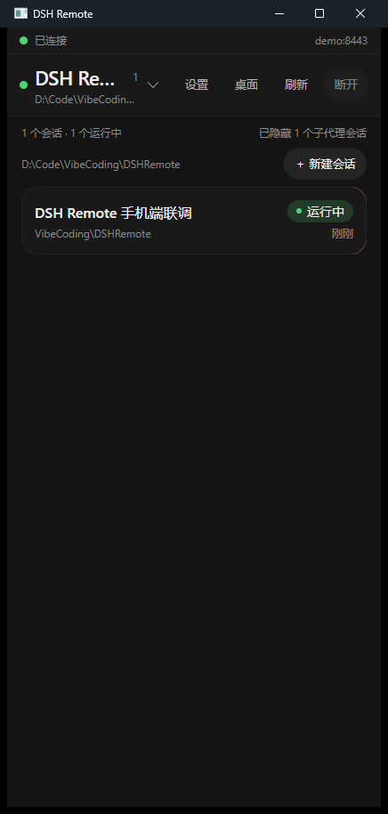

# 27 · 会话列表「隐藏动作透色」根因分析：是 Arc 组件库的渲染问题吗？

> 日期：2026-11-10
> 对象：`DSHRemote`（Avalonia 12.1.4 / Android；Windows 桌面壳复现）与 `Arc.Avalonia`
> 现象：会话列表行**收起（未滑动）**时，右边缘上下两个圆角处可见 1–2 px 砖红色弧线，正常使用中容易被读成「卡片描边偏暖」
> 证据：`docs/analysis/swipe-leak/`（修复前后/拖动中截图、像素断言、REPORT、DSHRemote diff、`_before/` 源码留档）；复现图 `shots/repro-demo-412.png`
> 相关：[docs/25 手机端使用建议](25-mobile-usage-guidance.zh.md)、[docs/28 滑动操作集成指南](28-swipe-actions-integration.zh.md)
> 说明：`DSHRemote` 是**外部仓库**，本文中它的路径统一写作 `DSHRemote/app/src/...`（相对该仓库根）；本仓库文件用仓库相对路径。

---

## 0. 结论（先给答案）

**不是 Arc 组件库的渲染缺陷，是 DSHRemote 的集成用法错误。**

DSHRemote 在会话列表的 ItemTemplate 里，把 `ArcDanger` 填充的「归档」按钮当成与 `Border.row-card` **同一 Grid 的下层子元素常驻绘制**，收起态只靠不透明卡片「遮住」它。但卡片右边缘是 `CornerRadius=18` 的圆角——圆角弧段的每个像素都是**部分覆盖**（抗锯齿），部分覆盖就意味着与下层颜色按比例混合。于是危险色从右边缘上、下两个圆角弧段渗出来：实测是 `ArcDanger` 以 **7%–38% 覆盖率**叠在页面背景上的混合色（如 `#6E3C3A`、`#5B3534`、`#593634`）。

| 归属 | 结论 | 关键依据 |
|---|---|---|
| DSHRemote（宿主） | **主责：集成用法错误** | 归档按钮收起态仍参与绘制（修复前 `SessionsView.axaml:115-121`），动作显隐只绑 `CanArchive`，与手势状态无关；「卡片圆角遮挡」在抗锯齿下不成立（§2.2） |
| Arc.Avalonia（组件） | **无渲染责任** | `ArcSwipeActions` 收起态把两侧动作 host 置 `IsVisible=false`（`src/Components/Arc.Avalonia.Media/Controls/ArcSwipeActions.cs:321-337`，`BuildActions` 末尾再套用一次 `:220`），动作连测量/绘制都不参与 |
| Arc.Avalonia（文档/契约） | **次要：文档缺一条通用不变式** | 增强前版本的 `Docs/swipe-actions.json` `whenNotToUse`（旧行号 `:15-19`）只写了「行要可点击时不要包滑动层」，没有写「宿主自绘滑动时，收起态也不得让动作参与绘制」；已在 [docs/28](28-swipe-actions-integration.zh.md) 补齐，并加了文档页回归示例与像素断言脚本（§6） |

**当前状态**：宿主侧已修（按钮 `Opacity="0"`，由 `SetActionPainted(bool)` 随手势切换，diff 见 §5）；同一 `--demo` 场景修复后卡片外圈条带的危险色像素为 **0**。Arc 侧**没有改控件**：只新增了文档页的「收起态 + Danger」回归示例（`SwipeActionsPage.cs:56-68`）与断言脚本 `tools/verify-swipe-leak.ps1`。

三条明确排除的误判：

- **不是 Arc 组件渲染缺陷**：同场景下 `ArcSwipeActions` 收起态零危险色像素（§2.4）。
- **不是 Avalonia 的圆角/抗锯齿 bug**：部分覆盖再混合下层颜色是抗锯齿的正确行为；把颜色放在下面、再指望圆角「挡掉」它，才是前提错误。
- **不是手机上没有**：只是手机截图被缩放/重编码后，1–2 px 的接缝被平均掉了（§3）。

---

## 1. 现象与复现

### 1.1 视觉表现

- 出现在 DSHRemote 会话列表的每一行：行**未滑动**时，右边缘靠近上下圆角的位置有 1–2 px 的暖红色细边，右下角更明显，像一道很淡的红色描边弧。
- 滑动过程中动作正常露出（红色「归档」按钮完整显示）；松手回位后红边重新出现。
- 只在右侧有 **Danger 色动作**时出现；归档按钮不可用的行（`CanArchive=false`，按钮 `IsVisible=false`）没有红边。
- 在暗色主题下不刺眼，容易被当成「卡片描边色偏暖」或「阴影」，因此长期没被单独报为缺陷。

### 1.2 桌面壳复现（主证据）

DSHRemote 自带一个 `--demo` 桌面壳（`DSHRemote/app/src/DshRemote.App.Desktop/Program.cs:25-34`），用演示数据渲染与手机端一致的会话列表视图。复现步骤：

```powershell
# 启动 DSHRemote 桌面壳的演示数据
DSHRemote.App.Desktop.exe --demo

# 把窗口拉窄到手机宽度并抓图（本仓库工具，PrintWindow 抓原始像素）
pwsh -File tools/capture-window.ps1 -ProcessName DshRemote.App.Desktop `
    -Out shots/repro-demo-412.png -Width 412 -Height 915
```

抓到 436×915 的位图。窗口 `MinWidth=420`（`DSHRemote/app/src/DshRemote.App/Views/MainWindow.axaml:6`），所以请求 412 的宽度会被系统抬到最小宽度：内容区 420 px，加左右各 8 px 非客户区边框后正好 436 px。`shots/repro-demo-412.png` 与 `docs/analysis/swipe-leak/before-demo-412.png` 是同一张图（SHA-256 一致）。下图是整窗原始像素——红色弧线在缩略图里很淡，需按 §2.2 的坐标取色或放大查看：



> 修复后的同一窗口见 [`analysis/swipe-leak/after-demo-412.png`](analysis/swipe-leak/after-demo-412.png)；拖动中（动作正常显示）见 [`swipe-mid-drag-412.png`](analysis/swipe-leak/swipe-mid-drag-412.png)。

### 1.3 手机侧观察与取证限制

真机上肉眼能看到同样的红边，但现有手机截图（`shots/swipe-red-leak-7428.jpg`，727×1600）在像素层面**抓不到**它——原因与取证方法见 §3，不能据此下「手机上不存在」的结论。

---

## 2. 证据链

### 2.1 宿主实现（修复前）

DSHRemote 的会话行模板（留档于 [`_before/SessionsView.axaml`](analysis/swipe-leak/_before/SessionsView.axaml)）：

```xml
<!-- 修复前：ItemsControl.ItemTemplate，:112-159 -->
<Grid Margin="0,0,0,8" ClipToBounds="True">

  <!-- 归档动作：同 Grid 的下层子元素，永远绘制；显隐只跟 CanArchive 走 -->
  <Button Classes="archive-action"
          Content="归档"
          Command="{Binding ArchiveCommand}"
          IsVisible="{Binding CanArchive}"
          HorizontalAlignment="Right"
          Width="96" />

  <!-- 行表面：点击打开会话，横向拖动露出归档按钮（代码里平移卡片） -->
  <Border Classes="row-card"
          PointerPressed="OnSessionRowPointerPressed"
          PointerMoved="OnSessionRowPointerMoved"
          PointerReleased="OnSessionRowPointerReleased">
    ...
  </Border>
</Grid>
```

| 文件 | 行号（修复前） | 内容 |
|---|---|---|
| `DSHRemote/app/src/DshRemote.App/Views/SessionsView.axaml` | `:110-162` | 会话行 ItemTemplate；`:112` 外层 Grid（`ClipToBounds=True`）；`:115-121` 归档 Button（`Width=96`、右对齐、`IsVisible` 只绑 `CanArchive`）；`:124-159` `Border.row-card` |
| `DSHRemote/app/src/DshRemote.App/Theme/AppStyles.axaml` | `:45-51` | `Border.row-card`：`Background=ArcSurface`、`BorderBrush=ArcBorderSubtle`、`BorderThickness=1`、`CornerRadius=18` |
| 同上 | `:87-98` | `Button.archive-action`：`Background=ArcDanger`、`Foreground=White`、`CornerRadius=18`、右对齐、纵向拉伸 |
| `DSHRemote/app/src/DshRemote.App/Views/SessionsView.axaml.cs` | `:74-201` | 自绘手势：按下记录起点、横向主导才 `CapturePointer`、`TranslateTransform.X` 平移卡片（`-96..0`）、松手按 `-48` 停靠或回位；**没有任何「动作是否绘制」的状态** |
| 同上 | `:198-212` | `EnsureState` 只建 `TranslateTransform` 与 `Open`，不持有动作按钮 |

结论：归档按钮在收起态是**正常参与绘制的一层不透明 Danger 填充**，卡片只是画在它上面。

### 2.2 为什么「不透明卡片遮挡」在物理上不成立

卡片和按钮共享同一轮廓：两者都撑满行高、右边缘都对齐到同一像素列（截图坐标 x=411），卡片是 `CornerRadius=18` 的圆角矩形，按钮（`CornerRadius=18`）也几乎同轮廓地躺在下面。

- **直边**：轮廓与像素网格对齐，卡片最外圈 1 px 描边（`ArcBorderSubtle` = `#222222`）完全不透明地盖住下层 → 中性灰。
- **圆角弧段**：曲线无法与像素网格对齐，每个像素的覆盖率 `c ∈ (0,1)`。该像素的颜色是 `c × 卡片色 + (1−c) × 下层色`；`1−c` 的部分把下面的 Danger 填充按比例带了上来。

这跟「描边太细」无关，也跟 `ArcBorderSubtle` 是否半透明无关（它是 `alpha=1` 的 `#222222`）：**只要动作按钮与卡片共享轮廓、且仍在绘制，圆角处就必然有像素落在卡片覆盖率之外**。如果卡片换成半透明表面、玻璃效果或带 alpha 的描边，渗色会从「圆角弧段」扩大为「整条边」。

实测取色（修复前 `before-demo-412.png`，均为原始像素，未缩放）：

| 位置 | 坐标 (px) | 颜色 | 说明 |
|---|---|---|---|
| 右侧直边 | (411, 250) | `#222222` | 1 px 描边完全覆盖，中性（对照） |
| 右上圆角弧 | (404, 213) | `#6E3C3A` | 危险色覆盖率约 38%（R 通道解算） |
| 右下圆角弧 | (408, 278) | `#6E3C3A` | 同上，最亮的一类渗色像素 |
| 右上近角 | (411, 224) | `#5B3534` | 覆盖率约 30% |
| 右下近角 | (409, 276) | `#593634` | 覆盖率约 29% |
| 左边缘（对照） | (24, 250) | `#222222` | 同一条描边，左侧没有动作按钮 → 中性 |
| 左上圆角弧（对照） | x≈24-40, y≈210-228 | `#1D1D1D`–`#222222` | 只混入页面背景，中性灰 |
| 卡片表面 | (200, 250) | `#191919` | `ArcSurface`（深色主题） |
| 页面背景 | (10, 250) | `#141414` | `ArcBackground`（深色主题） |

混合模型可以逐像素对上。深色主题下相关 token（`src/Foundation/Arc.Avalonia/Theme/ArcPalette.cs:93-106`，OKLCH 经 `ArcColor.Oklch` 转 sRGB）：

| token | OKLCH | sRGB |
|---|---|---|
| `ArcBackground` | `Oklch(0.19, 0, 0)` | `#141414`（20,20,20） |
| `ArcSurface` | `Oklch(0.215, 0, 0)` | `#191919`（25,25,25） |
| `ArcBorderSubtle` | `Oklch(0.25, 0, 0)` | `#222222`（34,34,34） |
| `ArcDanger` | `Oklch(0.76, 0.20, 25)` | `#FF736D`（255,115,109；R 通道在 sRGB 色域外被 clamp） |

以 `(404,213) = #6E3C3A` 为例：`#FF736D` 与 `#141414` 按覆盖率 `c≈0.38` 线性混合得到 `(110, 56, 54)`，与实测 `(110, 60, 58)` 一致（G/B 高 3–4，来自同一像素内还混入的一小部分中性描边/表面）。

### 2.3 像素级断言（修复前 → 修复后）

- **渲染**：DSHRemote Desktop 调试构建，`--demo`，窗口约 436 宽（修复前后截图 436×915，拖动中/回位后两张为 436×945），PrintWindow 抓原始像素（不经缩放/JPEG）。
- **危险色判据**：`R ≥ 60 && R − G ≥ 25 && R − B ≥ 25`。它排除了大部分弱色偏，但**挡不住白字 LCD 子像素抗锯齿的纯红通道**（见 §6.2），所以统计区域只取外圈条带。
- **统计区域**：会话卡片外圈条带（上/下/左/右各取一条），而不是整行矩形（原因见 §6.2）。
- 数据与截图：[`pixel-assert.md`](analysis/swipe-leak/pixel-assert.md)、[`before-demo-412.png`](analysis/swipe-leak/before-demo-412.png)、[`after-demo-412.png`](analysis/swipe-leak/after-demo-412.png)、[`swipe-mid-drag-412.png`](analysis/swipe-leak/swipe-mid-drag-412.png)、[`after-release-412.png`](analysis/swipe-leak/after-release-412.png)。

| 区域 | 修复前命中 | 修复后命中 | 说明 |
|---|---|---|---|
| 右边缘（红按钮所在侧，x400-412） | **30** | **0** | 上、下两个圆角弧段 |
| 下边缘（y277-288） | **12** | **0** | 右下圆角弧向下延伸的弧段 |
| 上边缘（y203-214） | **7** | **0** | 右上圆角弧 |
| 左边缘（对照，无动作按钮，x24-34） | 0 | 0 | 证明不是「整张卡片都偏红」 |

（本机按同一判据独立复算：右 30 / 下 12 / 上 8 / 左 0；上边缘比 `pixel-assert.md` 多 1 个，属条带边界定义差异，不影响结论。判据、条带定义以脚本为准。）

三组对照说明修复不是「把红色藏起来」而是「收起态不画」：

| 状态 | 危险色像素 | 截图 |
|---|---|---|
| 收起（修复前） | 右 30 / 下 12 / 上 7 | `before-demo-412.png` |
| 收起（修复后） | 右/下/上/左全部 **0** | `after-demo-412.png` |
| 拖动中（修复后，动作正常露出） | 右 **788** / 下 **418**（大范围命中） | `swipe-mid-drag-412.png` |
| 松手回位后（修复后） | 右/下/上/左全部 **0** | `after-release-412.png` |

「拖动中大量命中、回位后归零」这组正/负控制很关键：它同时排除了「截图路径（PrintWindow / 主题 / DPI）制造伪色」和「修复后按钮被永久隐藏」两种误读。

### 2.4 Arc 侧对照：`ArcSwipeActions` 收起态根本不画动作

`src/Components/Arc.Avalonia.Media/Controls/ArcSwipeActions.cs`：

- `ApplyOffset`（`:321-355`）是唯一的动作显隐入口：

  ```csharp
  var open = Math.Abs(value) > 1;

  // Only the side being revealed may be painted; the gap the surface leaves on the opposite edge
  // must stay empty rather than exposing the other action stack.
  if (_leadingHost is not null)
  {
      _leadingHost.IsVisible = value > 0.5;
  }

  if (_trailingHost is not null)
  {
      _trailingHost.IsVisible = value < -0.5;
  }
  ```

  即 `|offset| ≤ 0.5`（收起态）时两侧 host 都是 `IsVisible=false`。
- `BuildActions`（`:188-221`）重建动作按钮后，末尾 `:220` 再次调用 `ApplyOffset(_offset)`，所以模板应用/动作列表变化后也回到正确显隐状态。
- `OnApplyTemplate`（`:165-179`）在 `:177` 调 `BuildActions`，新建的行同样从「不画」开始。
- 主题 `src/Components/Arc.Avalonia.Media/Themes/ArcSwipeActions.axaml:82-108`：`Frame` 是圆角 + `ClipToBounds=True`（`:87`），`PART_Surface`（`:97-106`）盖在动作 host 之上、并随 `TranslateTransform` 平移；这层裁剪只是第二道保险，**关闭态不依赖它遮挡**。
- 键盘/焦点同样跟开合状态走：`AfterSettle`（`:304-319`）与 `ApplyOffset`（`:339-347`）只在露出时把动作按钮设为 `IsTabStop=true`；`OnPointerCaptureLost`（`:609-621`）复位并 `Close()`。

结论：Arc 组件的收起态**不存在红色图层**，卡片圆角无论怎么抗锯齿都没有颜色可渗。Arc 侧唯一新增的是文档页回归示例（`src/Docs/Arc.Avalonia.Docs/Components/Arc.Avalonia.Media/Pages/SwipeActionsPage.cs:56-68`）：第 4 行收起、Trailing 含 `Delete(Danger)`，其外圈条带必须零危险色像素，上方已露出的 Delete 行作为正控制。`REPORT.md` 最终结论：暗/亮两主题断言行**均为 0 px**，正控制行分别为 **5251 / 5246 px**，**PASS**。

### 2.5 为什么 DSHRemote 当初要自绘（这是设计约束，不是 Arc 的 bug）

增强前（旧版）`whenNotToUse` 的第 2 条原文（当时位于 `swipe-actions.json:17`；2026-11-10 已改写，见 §6.4）：

> 「行本身要响应点击（打开详情）时不要包滑动层，按压会被用来起拖。」

DSHRemote 的会话行**必须**响应点击（打开会话），所以它不能直接把行包进 `ArcSwipeActions`——`ArcSwipeActions` 的按压语义被定义为「起拖」。宿主在「行可点击」与「横向手势」之间做取舍、自绘手势，是合理决策。**错误只发生在隐藏方式**：自绘时把动作当成「反正会被卡片盖住」的常驻图层。（增强前结论；2026-11-10 组件增强后，可点击行可直接把 Button 放进 `Content` 复用组件，见 §6.4 与 [docs/28 §2.7](28-swipe-actions-integration.zh.md)。）

---

## 3. 为什么手机截图看不清（不能写成「手机上不存在」）

`shots/swipe-red-leak-7428.jpg` 是 727×1600；真机 `PLQ110` 的分辨率是 1272×2800，两者恰好差 4/7——它是一张**被缩放并重编码**的截图，不是原始像素。

- 1–2 px 的边缘像素在 0.571 倍缩放时会被邻域平均：渗色像素与相邻暗像素混合后 `R−G` 色差降到判据阈值以下（下方实测）。
- 用主判据 `r >= 60 && r−g >= 25 && r−b >= 25` 扫描 7428 全图：**0 命中**。
- 放宽为 `r >= 60 && r−g >= 15 && r−b >= 15`：只有 **1 个像素**（`(143,433) = (120,105,98)`），是标题文字的彩边，不在卡片右边缘。
- 去掉 R 通道下限、只要求 `r−g >= 15 && r−b >= 15`：27 个像素，bbox `x24-297, y96-718`，全部分布在文字区，仍不在卡片边缘。
- 聊天软件/文档预览里的缩略图二次缩放，进一步把这个差异抹平。

**结论**：手机截图「看不出来」是取证链路的分辨率问题，不是现象不存在。真机取证应抓**原始分辨率**截图，再对右边缘与四个角做 4–8 倍最近邻放大，或直接跑像素断言；判断有无缺陷不要依赖缩放后的缩略图。这也是 [docs/28 §5](28-swipe-actions-integration.zh.md) 把它写进排查清单的原因。

---

## 4. 逐项裁决表

| 现象/指控 | 裁决 | 关键证据 |
|---|---|---|
| 收起态右边缘/圆角有砖红色细边 | **宿主问题**：Danger 动作常驻绘制 + 卡片圆角抗锯齿 | 修复前 `SessionsView.axaml:115-121`；`before-demo-412.png` 外圈条带右 30 / 下 12 / 上 7 px；颜色 `#6E3C3A` 等 |
| 「Arc 的滑动组件也会透色」 | **不成立**：Arc 收起态动作 host `IsVisible=false` | `ArcSwipeActions.cs:321-337`、`:220`；文档页收起行断言 0 |
| 「是 Avalonia Border 圆角/抗锯齿的 bug」 | **不是**：部分覆盖混合下层是抗锯齿的正确行为；前提是宿主把颜色放在下层 | §2.2 的覆盖率模型与逐像素混合 |
| 「是 Danger 主题色太亮/太透明」 | **不是**：`ArcDanger` 不透明；渗出的是边缘覆盖率，不是颜色 alpha | `ArcPalette.cs:106`、`ArcColor.Oklch`；直边/左边缘为中性 `#222222` |
| 「桌面壳截图是 PrintWindow 的 artifact」 | **不是**：同一窗口拖动时红色按钮正常显示，松手后归零 | `swipe-mid-drag-412.png` 右 788 px → `after-release-412.png` 0 px |
| 「手机上不存在」 | **不成立**：截图被缩放到 727×1600，接缝被平均 | §3；主判据扫描 0 命中、放宽阈值仅 1 个非边缘像素 |
| 「Arc 无责任，所以不用改文档」 | **部分不成立**：组件无责，但缺少「宿主自绘也不得让收起态动作参与绘制」的通用不变式 | `swipe-actions.json:16-20`（增强前为 `:15-19`）；已补 [docs/28](28-swipe-actions-integration.zh.md) |

---

## 5. 修复（宿主侧，已落地）

### 5.1 原则

**收起态让动作不参与绘制，而不是让卡片去遮住它。** 具体做法与时机：

1. XAML 中归档按钮初始 `Opacity="0"`（并给 `x:Name` 便于 code-behind 拿引用）；
2. 手势状态机持有动作按钮引用，用 `SetActionPainted(bool)` 统一切换；
3. 拖动开始（横向锁定并捕获指针）→ 显示；停靠打开 → 保持显示；回位/点击收起/关闭其他行/行首次创建 → 隐藏。

### 5.2 关键代码片段

```xml
<!-- DSHRemote/app/src/DshRemote.App/Views/SessionsView.axaml:121-129（修复后） -->
<Button x:Name="ArchiveAction"
        Classes="archive-action"
        Content="归档"
        Command="{Binding ArchiveCommand}"
        CommandParameter="{Binding}"
        IsVisible="{Binding CanArchive}"
        Opacity="0"          <!-- 收起态不绘制：卡片的圆角抗锯齿边缘盖不住下层 Danger 填充 -->
        HorizontalAlignment="Right"
        Width="96" />
```

```csharp
// DSHRemote/app/src/DshRemote.App/Views/SessionsView.axaml.cs:251-262（修复后）
public void SetActionPainted(bool painted)
{
    if (Action is null)
    {
        return;
    }

    Action.Opacity = painted ? 1 : 0;
    // 隐藏的动作也不能继续占 Tab 焦点与命中测试。
    Action.IsTabStop = painted;
    Action.IsHitTestVisible = painted;
}
```

`RowSwipeState` 在 `EnsureState` 里通过 `FindArchiveAction` 找到模板里的归档按钮（`SessionsView.axaml.cs:203-234`），创建时立即 `SetActionPainted(false)`（`:213`）。调用点：

| 时机 | 行号（修复后） | paint |
|---|---|---|
| 首次创建行状态 | `:213` | `false` |
| 关闭其他已打开的行 | `:94` | `false` |
| 横向锁定、开始拖动 | `:127` | `true` |
| 松手停靠为打开 | `:155` | `true` |
| 松手回位 | `:162` | `false` |
| 点击收起已打开的行 | `:186` | `false` |

完整 diff（不含全文，只引路径）：

- [`analysis/swipe-leak/dshremote-sessionsview.diff`](analysis/swipe-leak/dshremote-sessionsview.diff)
- [`analysis/swipe-leak/dshremote-sessionsview-cs.diff`](analysis/swipe-leak/dshremote-sessionsview-cs.diff)
- 修复前源码留档：[`analysis/swipe-leak/_before/`](analysis/swipe-leak/_before/)

### 5.3 为什么用 `Opacity` 而不是 `IsVisible`

两者都满足「不参与绘制」：`IsVisible=false` 更彻底（同时退出布局、命中与 Tab 焦点），`Opacity=0` 则不触发布局、方便以后做淡入。本次选择 `Opacity` 是为了拖动开始时动作「立刻出现」且不引起行内容重排；**隐藏态按钮的 `IsTabStop` 与 `IsHitTestVisible` 也一并随 `SetActionPainted` 关闭**（`SessionsView.axaml.cs:251-262`），避免 Tab 焦点停在一个透明按钮上。这与 `ArcSwipeActions` 内部的处理一致（`ArcSwipeActions.cs:339-347`）。

无论选哪种，验收标准相同：**收起态外圈条带危险色像素为 0**。

### 5.4 修复后验证

| 检查 | 期望 | 结果 |
|---|---|---|
| 收起态外圈条带 | 0 危险色像素 | 右/下/上/左全 0（`after-demo-412.png`） |
| 拖动中 | 动作正常显示（正控制） | 右 788 / 下 418 px（`swipe-mid-drag-412.png`） |
| 松手回位 | 回到 0 | 全 0（`after-release-412.png`） |
| 左边缘对照 | 前后都是 0 | 0 / 0 |
| 同一场景视觉复查 | 右边缘无红色弧 | 圆角弧段变为中性 `#1A1A1A`–`#1D1D1D` |

### 5.5 外部仓库的两个注意点

- **改动只在宿主**：本次没有修改 `ArcSwipeActions` 或任何 Arc 组件源码（`git status` 中 Media 组件仅文档页 `SwipeActionsPage.cs` 有改动）。
- **如果 DSHRemote 还有影子副本**（例如 `_dev/` 下的校验/备份目录），需要同步这次 `SessionsView.axaml(.cs)` 改动，否则从影子副本构建的 APK 会复现旧问题（`docs/26` 的 Markdown 案例踩过同样的坑）。

---

## 6. 防回归

### 6.1 Arc 文档页新增「收起态 + Danger」示例

`src/Docs/Arc.Avalonia.Docs/Components/Arc.Avalonia.Media/Pages/SwipeActionsPage.cs:56-68` 在页面末尾新增第 4 行：**收起**、`Trailing = [Archive, Delete(Danger)]`。它的存在本身就是断言对象：

- 收起态行若出现任何危险色像素，说明组件或主题的「关闭态不画动作」被破坏；
- 上方已露出的 `Archive + Delete` 行是**正控制**：同一扫描必须找到红色 Delete 按钮，证明判据在当前主题下能识别 `ArcDanger`；
- 状态 key 与 `Docs/swipe-actions.json` 的 `state-closed` / `variant-danger-action` 对齐，文档与实现不会漂移。

### 6.2 像素断言脚本 `tools/verify-swipe-leak.ps1`

- 渲染 `swipe-actions` 文档页（暗/亮两主题，`--offset 300` 让演示画布完整入镜），逐行识别行矩形，对**收起态断言行**统计**外圈 6 px 条带**（`$ringThickness = 6`，`:69`）的危险色像素并要求为 0；同时用上方展开行的右侧 168 px 危险填充作正控制。
- 断言判据（`$ringDanger`，`:73`）：`r >= 60 && r - g >= 25 && r - b >= 25`——故意宽松的「偏红/不中性」规则，只因为条带内没有文字；它能抓到 `(110,60,58)` 这类混合渗色。扫描函数 `Measure-DangerRing`（`:402`）基于 `Measure-DangerPixels`（`:354`）。
- 正控制判据（`$fillDanger`，`:76`）：`r >= 150 && r - g >= 60 && r - b >= 55`——要求是**真正的 ArcDanger 填充**而不是抗锯齿边缘；控制区宽 168 px（`:82`）、命中数下限 1000（`:83`）。
- 整行矩形谓词 `r >= 120 && r - g >= 50 && r - b >= 50`（`$fullRowDanger`，`:79`）**只用于诊断，不作为断言**（`$diagnosticRule`，`:87`）。
- 失败语义：`0 = PASS`，`1 = FAIL`，`2 = 渲染/行检测失败`；证据写到 `docs/analysis/swipe-leak/`（`render/` 切片、annotated PNG、`report.json`、`REPORT.md`）。
- **踩过的坑（保留记录）**：首版把整行矩形都算进扫描区，结果把白色文字的 LCD 子像素抗锯齿当成危险色——暗色主题下第 0 行明明没有任何红色动作，却报 49 px，命中颜色全是 `(160,25,25)` 这类文字边缘（`REPORT.md` 的说明里列了 `#A01919`、`#BB7719`、`#D0A019` 等实例）。修法是**只扫外圈 6 px 条带**（文字至少离行表面边缘 16 px），整行计数降级为诊断。最终 `REPORT.md`：暗/亮断言行 0 px、正控制 5251/5246 px，**PASS**。
- 宿主侧也可复用：DSHRemote 的 `before/after/mid-drag/after-release` 四张图就是用 `tools/capture-window.ps1` + 同一危险色判据跑出来的（[`pixel-assert.md`](analysis/swipe-leak/pixel-assert.md)）。

### 6.3 文档契约

- [docs/28](28-swipe-actions-integration.zh.md) 把「收起态动作不得参与绘制」写成第一条不变式，并给出 Arc / 自绘两条路径的正确骨架与排查清单。
- [docs/25](25-mobile-usage-guidance.zh.md) §3 的 `ArcSwipeActions` 行补充「收起态组件自身不绘制动作、无透色；宿主自绘必须收起态隐藏动作」，§5 已知问题新增本项（已定位/已修）。

### 6.4 可选加固（不阻塞本次）

1. 给自绘滑动的宿主一个可复用的约定：动作按钮必须由手势状态机统一控制 `Opacity/IsVisible`，不要在 XAML 里只绑业务可见性；
2. Arc 若未来暴露「自定义动作 host」或允许重模板，文档里要显式声明 `PART_LeadingHost/PART_TrailingHost` 在 `|offset| ≤ 0.5` 时必须 `IsVisible=false`（当前实现已如此，但没有契约文字）；
3. 像素断言的条带范围、判据与正控制写进 CI 说明，避免下次又用整行矩形扫描导致误报。
4. **后续（2026-11-10）**：`ArcSwipeActions` 已做「可点击行」增强——按压改为隧道监听、横向锁定后才夺取指针，轻点会到达 `Content` 内的 Button/Tapped 表面；本文 §2.5 引用的 `whenNotToUse`「行本身要响应点击时不要包滑动层」限制已解除（该条 json 原文已改写）。新的标准写法见 [docs/28 §2.7](28-swipe-actions-integration.zh.md)。本次 RCA 的结论、像素证据与修复方式不受此增强影响。

---

## 7. 一句话结论

- **对 DSHRemote 维护者**：你看到的红边不是 Arc 的渲染缺陷，而是你自己的行模板把 Danger 按钮常驻画在了卡片下面。卡片圆角在抗锯齿下必然部分透明，遮不住下层颜色。让动作按钮在收起态 `Opacity=0`（或 `IsVisible=false`），由手势状态机在拖动/停靠时打开即可；别再把「卡片遮挡」当隐藏手段。
- **对 Arc 维护者**：本次组件无责，但文档只写了「行要可点击时别用滑动层」，没把「自绘时收起态不得绘制动作」写成通用契约，宿主很容易用圆角卡片去赌抗锯齿。已补 docs/28、文档页收起+Danger 示例与像素断言；针对本次透色问题组件源码不需要改（2026-11-10 的「可点击行」增强另行新增隧道监听，见 §6.4）。

---

## 8. 证据与产物索引

| 证据 / 产物 | 位置 |
|---|---|
| 修复前桌面壳截图（436×915，原始像素） | [`analysis/swipe-leak/before-demo-412.png`](analysis/swipe-leak/before-demo-412.png)（= `shots/repro-demo-412.png`） |
| 修复后桌面壳截图 | [`analysis/swipe-leak/after-demo-412.png`](analysis/swipe-leak/after-demo-412.png) |
| 拖动中 / 松手回位截图 | [`swipe-mid-drag-412.png`](analysis/swipe-leak/swipe-mid-drag-412.png)、[`after-release-412.png`](analysis/swipe-leak/after-release-412.png) |
| 像素断言数据与判据 | [`analysis/swipe-leak/pixel-assert.md`](analysis/swipe-leak/pixel-assert.md) |
| 修复前源码留档 | [`analysis/swipe-leak/_before/SessionsView.axaml`](analysis/swipe-leak/_before/SessionsView.axaml)、[`_before/SessionsView.axaml.cs`](analysis/swipe-leak/_before/SessionsView.axaml.cs) |
| 宿主修复 diff | [`dshremote-sessionsview.diff`](analysis/swipe-leak/dshremote-sessionsview.diff)、[`dshremote-sessionsview-cs.diff`](analysis/swipe-leak/dshremote-sessionsview-cs.diff) |
| Arc 文档页回归示例 | `src/Docs/Arc.Avalonia.Docs/Components/Arc.Avalonia.Media/Pages/SwipeActionsPage.cs:56-68` |
| Arc 侧视觉回归报告（PASS） | [`analysis/swipe-leak/REPORT.md`](analysis/swipe-leak/REPORT.md)、[`report.json`](analysis/swipe-leak/report.json)、`swipe-leak-dark-annotated.png`、`swipe-leak-light-annotated.png` |
| 断言脚本 | `tools/verify-swipe-leak.ps1`；窗口抓图 `tools/capture-window.ps1` |
| 手机截图（缩放版，仅作现象参考） | `shots/swipe-red-leak-7428.jpg` |
| Arc 组件实现 | `src/Components/Arc.Avalonia.Media/Controls/ArcSwipeActions.cs`、`src/Components/Arc.Avalonia.Media/Themes/ArcSwipeActions.axaml` |
| Arc 文档数据（whenNotToUse） | `src/Docs/Arc.Avalonia.Docs/Components/Arc.Avalonia.Media/Docs/swipe-actions.json:16-20` |
| 组件模型（Tone/Action） | `src/Components/Arc.Avalonia.Media/Controls/ArcMediaModels.cs:14-49` |

---

## 附录 A · 关键文件与行号表

| 文件 | 行号 | 内容 |
|---|---|---|
| `DSHRemote/app/src/DshRemote.App/Views/SessionsView.axaml` | `:110-169` | 会话行 ItemTemplate（修复后）；`:112` 外层 Grid；`:114-120` 修复注释；`:121-129` 归档按钮（`Opacity="0"`）；`:132-167` `row-card` |
| 同上（修复前留档） | `:112-159` | `:115-121` 归档按钮无 `Opacity`；`:124-159` `row-card` |
| `DSHRemote/app/src/DshRemote.App/Theme/AppStyles.axaml` | `:45-51`、`:87-98` | `row-card`、`archive-action` 样式 |
| `DSHRemote/app/src/DshRemote.App/Views/SessionsView.axaml.cs` | `:76-100`、`:102-134`、`:136-201` | 按下 / 移动 / 释放手势 |
| 同上 | `:203-215`、`:217-234`、`:236-263` | `EnsureState`、`FindArchiveAction`、`RowSwipeState.SetActionPainted`（`:251-262`） |
| 同上（修复前留档） | `:74-201`、`:198-212` | 手势；`EnsureState`/`RowSwipeState`（无动作绘制状态） |
| `DSHRemote/app/src/DshRemote.App.Desktop/Program.cs` | `:25-34` | `--demo` 演示入口 |
| `src/Components/Arc.Avalonia.Media/Controls/ArcSwipeActions.cs` | `:67-68` | `ActionWidth=84`、`DragLock=6`；`:107-119` 隧道监听注册 |
| 同上 | `:165-179` | `OnApplyTemplate` → `BuildActions` |
| 同上 | `:188-221` | `BuildActions`，末尾 `ApplyOffset(_offset)` |
| 同上 | `:304-319` | `AfterSettle` 关闭时清空 Tab 停靠 |
| 同上 | `:321-355` | `ApplyOffset`：`IsVisible = value > 0.5 / value < -0.5`（`:329-337`） |
| 同上 | `:382-486` | 按下 / 移动：隧道监听、6 px 轴锁、纵向主导则放弃、横向锁定后才捕获 |
| 同上 | `:489-504` | `Resist`：越界阻尼 0.24 |
| 同上 | `:506-585` | 释放：FullSwipe 阈值 `max(width+48, rowWidth*0.56)`，停靠阈值露出宽度的 50% |
| 同上 | `:609-621` | `OnPointerCaptureLost` → `Close()` |
| 同上 | `:633-672` | 键盘 Left/Right/Escape |
| `src/Components/Arc.Avalonia.Media/Themes/ArcSwipeActions.axaml` | `:82-108` | `Frame`（圆角 + `ClipToBounds=True`）、两侧 host、`PART_Surface` |
| `src/Foundation/Arc.Avalonia/Theme/ArcPalette.cs` | `:93-106` | `ArcBackground/ArcSurface/ArcBorderSubtle/ArcDanger` 的 OKLCH 定义 |
| `src/Docs/.../Docs/swipe-actions.json` | `:16-20` | `whenNotToUse`（增强后；含「行本身要响应点击…」一段） |
| `src/Docs/.../Pages/SwipeActionsPage.cs` | `:56-68` | 收起态 + Danger 回归行 |
| `tools/verify-swipe-leak.ps1` | `:69-87`、`:354`、`:402` | 条带厚度与三组判据（`:73/:76/:79`）、`Measure-DangerPixels`、`Measure-DangerRing` |
| `tools/capture-window.ps1` | `:1-77` | 按尺寸抓窗口原始像素（PrintWindow） |
